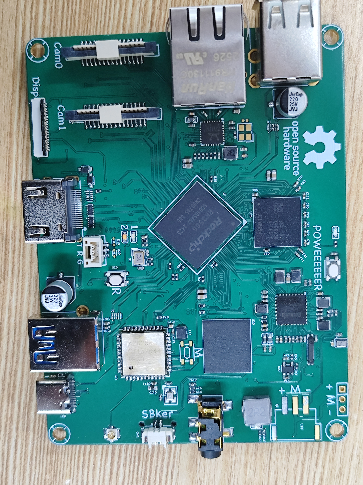
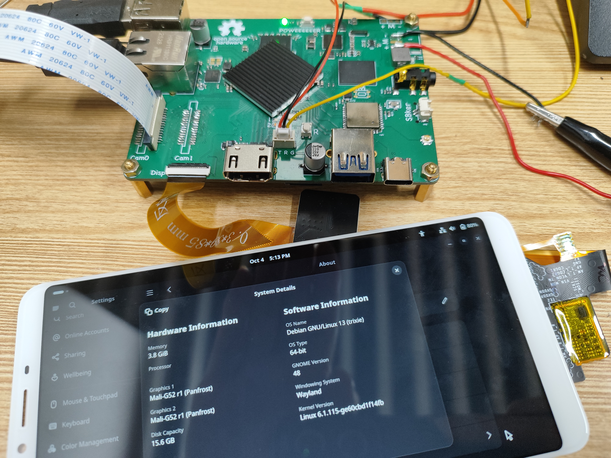
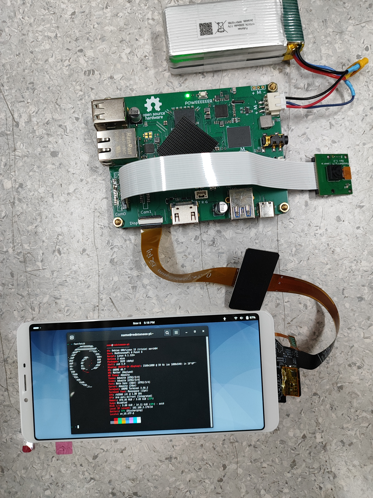
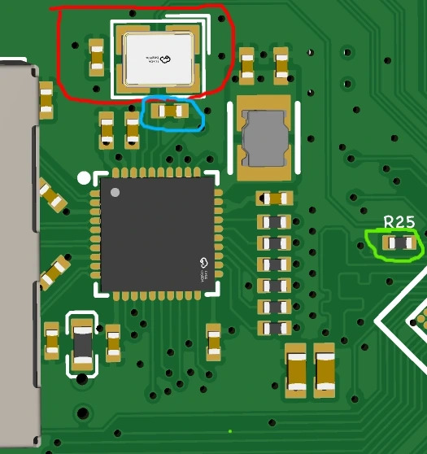

# RedStoneeePi-0Point6

A single-board computer based on RK3566

[Chinese version - OSHW Hub](https://oshwhub.com/dc_redstone/project_pumgrlpb)





## Interfaces

* XH2.54-3p 2S Lithium Battery Connector
* USB Type-A Host (2x 2.0, 1x 3.2 Gen 1)
* USB Type-C Device (2.0, could be used for charging)
* Gigabit Ethernet
* 2x MIPI CSI (2-lane, compatible with RPi 15-pin camera)
* HDMI Type-A
* Micro SD
* MIPI DSI (4-lane, compatible with Radxa Rock 4/5)
* 3.5mm Audio Jack
* HC1.25 Speaker Connector
* PCIe 2x1 FPC/FFC
* Dual-band WiFi and BT
* On-board Microphone

## Hardware Guide

### Power Supply

This board is powered by a lithium battery. 
Connect a 2S lithium battery to the board through the XH2.54 connector,
then press the power button to turn it on.

The board integrates a balanced charging circuit.
You can connect a 5 V power supply, or a power supply that supports QC fast charging,
through the USB-C port to charge the battery.
You can also connect a regulated 7–12 V power supply to the XH2.54 connector.

The RK809-5 includes a coulomb counter, so the battery level can be viewed in the system.
However, the battery parameters must be configured correctly in the device tree;
otherwise, the reported battery level will be inaccurate.

Unfortunately, if you want to power the board through USB,
you will have to modify the PCB yourself.

### DRAM

This board uses LPDDR3 memory for two main reasons:

* LPDDR4/4x memory is currently very expensive;
* The RK3566 DRAM controller supports speeds of up to 1056 MHz,
  so using LPDDR4/4x would be somewhat wasteful.

I could not find a reference design for RK3566 + LPDDR3,
so I designed this part myself.
It has been tested and is fairly stable at 920 MHz.

The [SPL](rk3566_lpddr3_920_spl_loader_v1.25.114.bin) and [U-Boot](u-boot.itb) images are included in the repository,
and you can use them to make your own system image.

### Ethernet

The RK3566 Ethernet controller integrates a 25 MHz clock output,
which can be directly used as the clock input for the PHY,
eliminating the need for an additional crystal oscillator.

For the components shown in the figure:
| Clock Source | Red Box     | Blue Box                          | Green Box   |
| ------------ | ----------- | --------------------------------- | ----------- |
| Crystal      | Populated   | Populated with the load capacitor | Unpopulated |
| RK3566 GMAC  | Unpopulated | Populated with a 0R resistor      | Populated   |




### PCIe

I have not tested this yet, but other boards (such as the RPi and A7z)
use the same design, so it should work.

### WiFi/BT

The default module is the AP6256, which supports dual-band Wi-Fi.
If you use another module, you need to replace the corresponding crystal oscillator.
The module must also support SDIO 3.0 because its I/O supply voltage is 1.8 V.

> [!NOTE] 
> Many second-hand RK3566 chips sold online are locked,
> so be careful when purchasing!
> 
> A locked chip will appear to hang
> when downloading a regular SPL loader in MaskROM mode.

### DSI and HDMI

The RK3566 has only one VOP and does not support displaying
different content on multiple screens.
If you want DSI and HDMI to display simultaneously,
you may need to use screens with the same resolution (up to 1920 × 1080).

In my testing, the DSI screen had a relatively high resolution,
and the HDMI output became corrupted when DSI was enabled.

If you do not use DSI, disable or remove the relevant device-tree nodes.

## Building Linux

The kernel I use comes from the Radxa repository.
The device-tree sources (including versions with DSI,
the touchscreen, and the backlight enabled or disabled)
and the [build configuration](src/redstoneeepi_rk_defconfig)
are included in the repository.

0. Clone the source code with this command:

```bash
git clone https://github.com/radxa/kernel -b linux-6.1-stan-rkr5.1 --depth 1
```

1. Copy `redstoneeepi_rk_defconfig` to `arch/arm64/configs`;
2. Copy `rk3566-redstoneeepi-0.6(_no-dsi).dts` to `arch/arm64/boot/dts/rockchip`;
3. Add the following line to `arch/arm64/boot/dts/rockchip/Makefile`:

```makefile
dtb-$(CONFIG_ARCH_ROCKCHIP) += rk3566-redstoneeepi-0.6.dtb
```

4. Load the build configuration with this command:

```bash
make shandongpi_defconfig ARCH=arm64
```

5. Build with this command:

```bash
make -j32 ARCH=arm64 CROSS_COMPILE=aarch64-linux-gnu- 
```

## Prebuilt Images

Available in [GitHub Releases](https://github.com/RedStoneeeTek/RedStoneeePi-0Point6/releases).

The image is based on Debian 13, only a command-line version is provided.
If you need a desktop environment, you can install one with `apt`.

In my testing, GNOME was running difficultly
because it required a lot of system resources.

Both device-tree versions (with DSI enabled or disabled) are included in the image.
You can select the appropriate device-tree
by modifying the `/boot/extlinux/extlinux.conf` file in the rootfs.
The default device-tree is `rk3566-redstoneeepi-0.6.dtb`, which has DSI enabled.

You can flash the image to an SD card with `dd`, `balenaEtcher` and so on;
or flash the image to the eMMC with `rkdeveloptool`, `upgrade_tool` and so on.

The default user is `name`, and the password is `233`.
